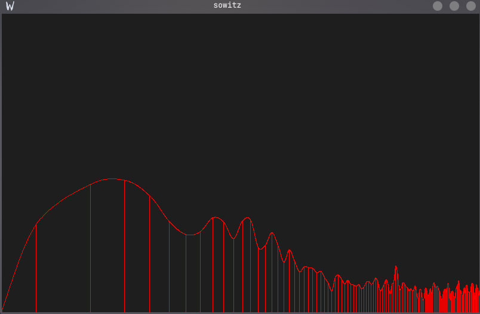

## **audio visualization engine**

real time audio spectrum analyzer built in C++ using PortAudio, FFTW3 and SDL3. Captures default system audio monitor sink and renders a live frequency domain visualization in a window.

**Current features**
- FFT-based frequency spectrum with logarithmic scaling
- Smooth magnitude interpolation via lerp
- Catmull-Rom spline curve over frequency peaks
- Lock-free double-buffered audio pipeline

**Planned**
- XY vectorscope mode. Raw stereo samples plotted as a 2D Lissajous figure
- Frequency based Lissajous figures driven by the two dominant FFT 
- Piano key detection and layout overlay

**Built with**
- PortAudio — audio capture
- FFTW3 — Fast Fourier Transform
- SDL3 — rendering

i enjoy building this for fun. and i hope to create something nice looking, some tricky, special audio visualizations look heavenly

### **Screenshot of current looks:**
\
